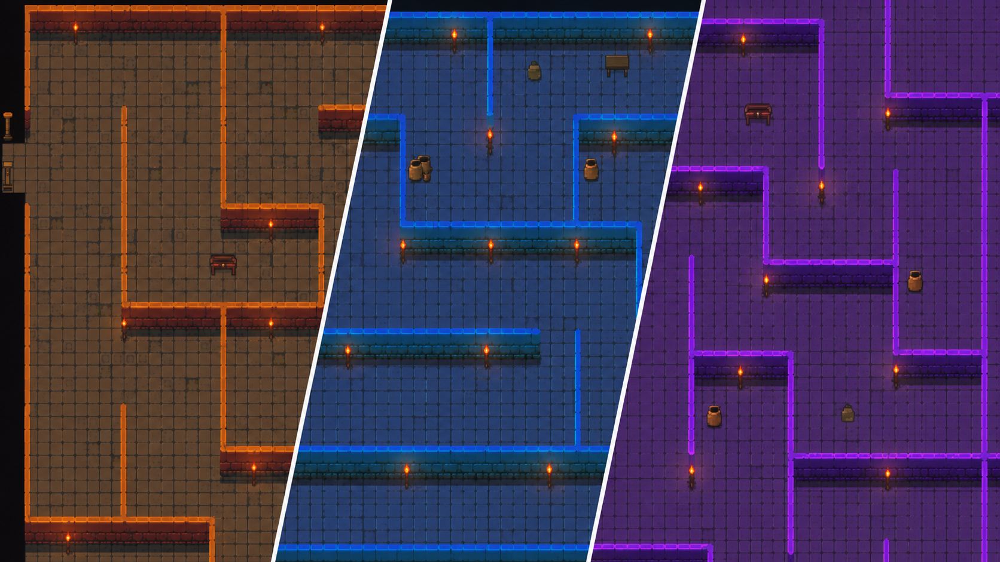

# Labyrinth Game
WPU Powershell



Name: Get-Lost  
Mindestalter: 21-99  

Basis:
- Bewegung
- Map/Level Generierung
- Key
- GUI als Windows-Programm (PowerShell + WPF), früher PHP-Webbrowser
- Starten per Doppelklick auf `Get-Lost.exe`, Spielmechanik komplett in PowerShell (früher Docker)

Erweiterung:
- Skin Shop
- Multiplayer (wenn noch Zeit da ist)
- Spielstand speichern in SQL DB
- Multiplayer Logik, ein Gerät ist der Hoster, und man verbindet sich mit der IP des Hosts
- Scoreboard (level timer als score?)
- Trolls/Fallen
- Gegner (wie bei Pacman?) ich denke man muss zusammen das ziel finden oder?

Arbeitsteilung:
- Steuerung (Lion)
- Docker Stuktur (Lion)
- Level Generierung (Babsi)
- GUI, Webbrowser (Michail)
- Und was macht Pascal

### Struktur

```
Get-Lost
├── app
│   ├── wpf (*Michail *ai)      Fenster, Grafik, Spielablauf (WPF)
│   │   ├── Start-GetLost.ps1   Startpunkt
│   │   ├── MainWindow.xaml     Start-/Ladebildschirm, Spielansicht
│   │   ├── mapRenderer.ps1     zeichnet die Karte (Boden, Mauern, Deko, Licht)
│   │   ├── game.ps1            Spielablauf + Levelwechsel
│   │   ├── player.ps1          Spielfigur + Steuerung
│   │   └── gameLogic.ps1       Spielregeln (Kollision, Münzen, Schlüssel, Tor)
│   └── maze-gen (*Babsi)
│       ├── main.ps1            erzeugt die Level
│       └── config.yml          Einstellungen pro Level (Größe, Farben, Möbel, ...)
├── public                      Bilder (Möbel, Tore, Münzen, Spielfigur)
├── tools
│   ├── Build-Exe.ps1           baut dist/Get-Lost.exe
│   └── generate-sprites.ps1
└── README.md
```

*ai - der größte Teil wurde mithilfe von AI erstellt. Der Code wurde von uns überprüft. Dies war notwendigt um eine vernünftige GUI zu haben.

### Wie Installiere ich das Game?

Nichts zu installieren: `dist/Get-Lost.exe` kopieren und doppelklicken (Windows 10/11).

Die .exe bauen (aus dem Ordner `Get-Lost`):
```
powershell -ExecutionPolicy Bypass -File tools\Build-Exe.ps1
```
Beim ersten Mal wird dafür das PowerShell-Modul `ps2exe` installiert.

### Wie startet sich das Spiel?

- Fertiges Programm: `dist\Get-Lost.exe` doppelklicken
- Beim Entwickeln direkt aus dem Code:
```
cd Get-Lost
powershell -ExecutionPolicy Bypass -File app\wpf\Start-GetLost.ps1
```

Steuerung: Pfeiltasten oder WASD, `Esc` = zurück zum Startbildschirm.

Eigene Einstellungen: Eine geänderte `config.yml` neben die `Get-Lost.exe` legen - sie wird dann statt der eingebauten benutzt.

### Wie soll Multiplayer funktionieren?
Man kann über ein Knopf ein Game Starten "Im LAN"
Andere Spieler können dann beitreten indem die auf "Im LAN suchen" klicken


### Maps

Die Level werden bei jedem Spielstart neu mit `app/maze-gen/main.ps1` aus der `config.yml` erzeugt (Level 1, 2, 3, ...). Nach dem letzten Level geht es zurück zum Startbildschirm.

Zum Testen geht der Generator auch allein:
```
powershell -ExecutionPolicy Bypass -File app\maze-gen\main.ps1 -Level 1
```

### Mechanics

Fehlen noch