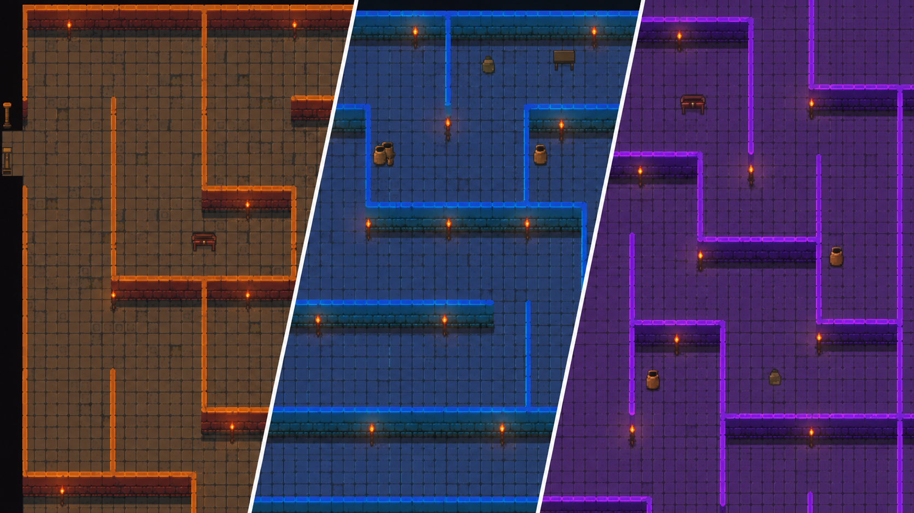

# Labyrinth Game
WPU Powershell



Name: Get-Lost  
Mindestalter: 21-99  

Basis:
- Bewegung
- Map/Level Generierung
- Key
- GUI als natives Windows-Fenster (WPF), komplett in PowerShell (app/native)
- Ausgeliefert als eine einzige `Get-Lost.exe` - keine Installation, kein Docker

Erweiterung:
- Skin Shop
- Multiplayer (wenn noch Zeit da ist)
- Spielstand speichern in SQL DB
- Multiplayer Logik, ein Gerät ist der Hoster, und man verbindet sich mit der IP des Hosts
- Scoreboard (level timer als score?)
- Trolls/Fallen
- Gegner (wie bei Pacman?) ich denke man muss zusammen das ziel finden oder?

Arbeitsteilung:
- Steuerung (Lion)
- Docker Stuktur (Lion)
- Level Generierung (Babsi)
- GUI, Webbrowser (Michail)
- Und was macht Pascal

### Struktur

```
Get-Lost
├── app
│   ├── browser (*Michail *ai)
│   ├── control (*Lion)
│   ├── maze-gen (*Babsi)
│   └── native  (Spiel-Client, wird zur EXE)
├── public (Sprites: hero, coins)
├── tools
│   └── Build-Exe.ps1 (baut dist/Get-Lost.exe)
└── README.md
```

*ai - der größte Teil wurde mithilfe von AI erstellt. Der Code wurde von uns überprüft. Dies war notwendigt um eine vernünftige GUI zu haben.

### Wie spiele ich das Game?

Die Spieler bekommen **nur die Datei `Get-Lost.exe`**. Doppelklick, fertig - keine Installation, kein Docker, kein Browser. Die EXE enthaelt alles (Skripte, Grafiken, Level-Konfiguration) und laeuft auf jedem Windows 10/11, weil Windows PowerShell 5.1 und WPF dort schon dabei sind.

Hinweis: Da die EXE nicht signiert ist, zeigt Windows SmartScreen beim ersten Start evtl. "Der Computer wurde durch Windows geschuetzt" - dann "Weitere Informationen" -> "Trotzdem ausfuehren".

### Wie baue ich die EXE?

Aus dem Repo-Root:

```powershell
powershell -ExecutionPolicy Bypass -File tools/Build-Exe.ps1
```

Ergebnis: `dist/Get-Lost.exe`. Das Skript

1. installiert beim ersten Mal das PowerShell-Modul [ps2exe](https://github.com/MScholtes/PS2EXE) (fuer den aktuellen Benutzer),
2. packt alle Dateien aus der Liste in `app/native/Resources.ps1` als Base64 zusammen mit `app/native/Start-GetLost.ps1` in ein einziges Skript (`build/Get-Lost.bundle.ps1`),
3. kompiliert dieses Skript mit ps2exe zu einer EXE ohne Konsolenfenster.

**Wichtig:** Wer eine neue Datei (Bild, Skript, ...) ins Spiel einbaut, muss sie in `$GetLostResourceFiles` in `app/native/Resources.ps1` eintragen und ueber `Get-GetLostText`/`Get-GetLostBytes`/`New-GetLostBitmap` laden - sonst fehlt sie in der EXE.

### Entwickeln (ohne EXE)

Zum Testen geht es schneller, das Spiel direkt aus dem Repo zu starten (dann sieht man auch die Konsolenausgaben):

```powershell
powershell -ExecutionPolicy Bypass -File app/native/Start-GetLost.ps1
```

### Wie funktioniert LAN?

LAN ist direkt in die EXE eingebaut (`app/native/LanClient.ps1`), ein zweites Programm ist nicht noetig.

- **Open to LAN**: sendet alle paar Sekunden einen UDP-Broadcast "ich hoste" ins lokale Netz.
- **Finding local games**: zeigt gefundene Spiele im lokalen Netz an - Klick auf einen Eintrag tritt der Lobby bei.

Wenn die Windows-Firewall beim ersten Start nachfragt: Zugriff erlauben (das Spiel braucht UDP-Port 45888 fuer die Suche und TCP-Port 5679 bzw. den naechsten freien fuer die Karte).

### Level

Die Level (Groesse, Komplexitaet, Muenzen, Farben, Moebel) stehen in `app/maze-gen/config.yml`. Die Datei wird beim Bauen in die EXE eingebettet - nach einer Aenderung also die EXE neu bauen.

### Mechanics

- Bewegung mit `WASD` oder den Pfeiltasten
- Richtungs- und Laufanimationen aus `public/hero`
- Kollision mit Waenden und Kartenrand
- Animiertes Einsammeln der Muenzen
- Im LAN beendet der Host beim Verlassen die Runde. Ein Gast kann eine noch laufende Runde verlassen und ueber den Hinweis im Menue wieder beitreten.
